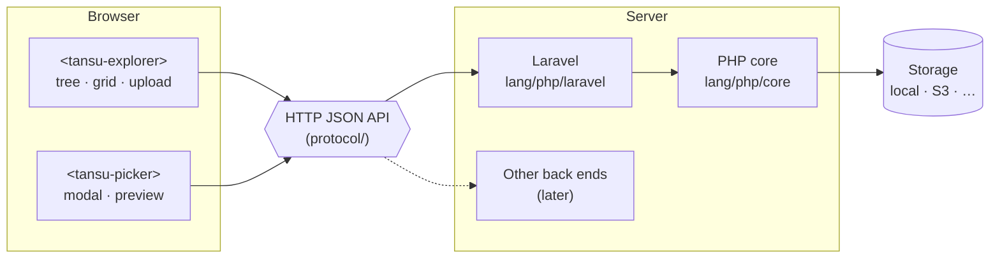

# tansu

**A lightweight media explorer for web apps — folders, uploads and an image picker, with no jQuery and no build step.**

Most file managers for web frameworks still ship jQuery, Bootstrap or a Vue bundle, and bring every feature of a desktop file manager with them. tansu aims at the common case instead: each owner (a company, a user, a team) keeps its own images in a folder tree, and forms pick from them. (*Tansu* is Japanese for a chest of drawers: things are put away in drawers and taken out when needed.)

> **Status:** pre-alpha. The layout and the plan are in place; nothing is released yet. See [docs/roadmap.md](docs/roadmap.md).

## What makes it different

- **No dependencies in the browser.** The UI is a set of Web Components (custom elements) shipped as plain ES modules. No jQuery, no Alpine, no framework, no bundler. It works next to whatever the host page already uses.
- **CSS-framework neutral.** A small stylesheet with CSS custom properties, so it fits Bulma, Bootstrap or a hand-written theme.
- **Owners and quotas built in.** Files live in a per-owner root; the host app decides who the owner is and who may do what. Limits per file and per owner (total size, file count).
- **Safe defaults.** Uploads are checked by content, not by extension; SVG is off unless enabled (and is sanitized when it is); file names are normalized; EXIF metadata is stripped.
- **One protocol, many back ends.** The UI talks to the server over a small, documented HTTP JSON API ([protocol/](protocol)). The PHP/Laravel back end comes first; other languages can implement the same API.

## Layout

| Path | What | Package |
|---|---|---|
| [ui](ui) | Web Components (JS + CSS), no build step | npm `@otaqq/tansu` (planned) |
| [lang/php/core](lang/php/core) | Framework-independent PHP: storage, validation, quotas, sanitizing | Composer `otaqq/tansu` |
| [lang/php/laravel](lang/php/laravel) | Laravel integration: routes, controllers, policies, config | Composer `otaqq/tansu` |
| [protocol](protocol) | The HTTP API the UI speaks | — |
| [conformance](conformance) | Language-independent tests for any back end that implements the protocol | — |
| `lang/ruby`, `lang/go`, … | Other back ends | later |

## License

MIT. See [LICENSE](LICENSE).
