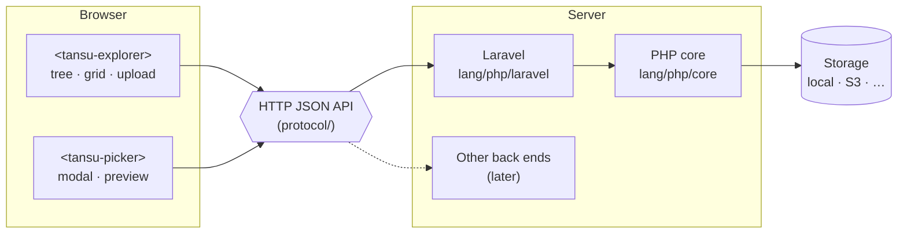

# tansu

**A lightweight media explorer for web apps — folders, uploads and a picker, with no jQuery and no build step.**

Most file managers for web frameworks still ship jQuery, Bootstrap or a Vue bundle, and bring every feature of a desktop file manager with them. tansu aims at the common case instead: each owner (a company, a user, a team) keeps its own images, PDFs and videos in a folder tree, and forms pick from them. (*Tansu* is Japanese for a chest of drawers: things are put away in drawers and taken out when needed.)

> **Status:** pre-alpha. The layout and the plan are in place; nothing is released yet. See [docs/roadmap.md](docs/roadmap.md).

## What makes it different

- **No dependencies in the browser.** The UI is a set of Web Components (custom elements) shipped as plain ES modules. No jQuery, no Alpine, no framework, no bundler. It works next to whatever the host page already uses.
- **CSS-framework neutral.** A small stylesheet with CSS custom properties, so it fits Bulma, Bootstrap or a hand-written theme.
- **Owners and quotas built in.** Files live in a per-owner root; the host app decides who the owner is and who may do what. Limits per file (one size, or a size per group: images, documents, videos) and per owner (total size, file count). The explorer shows them before an upload: the largest file and the accepted types, a usage meter, and a disabled upload button with the reason when the quota is full.
- **Safe defaults.** Uploads are checked by content, not by extension; SVG is off unless enabled (and is sanitized when it is); file names are normalized; EXIF metadata is stripped from images.
- **Optional image optimization.** When the app turns it on, the person uploading chooses per upload to keep the original, use a preset (such as "Logo, 600 × 600") or enter a size and quality. Images that cannot be processed safely (animated, or too large for the memory) are stored as they are, and the person and the log are told.
- **One protocol, many back ends.** The UI talks to the server over a small, documented HTTP JSON API ([protocol/](protocol)). The PHP/Laravel back end comes first; other languages can implement the same API.

## Layout

| Path | What | Package |
|---|---|---|
| [ui](ui) | Web Components (JS + CSS), no build step | npm `@otaqq/tansu` (planned) |
| [lang/php/core](lang/php/core) | Framework-independent PHP: storage, validation, quotas, sanitizing | Composer `otaqq/tansu` |
| [lang/php/laravel](lang/php/laravel) | Laravel integration: routes, controllers, policies, config | Composer `otaqq/tansu` |
| [protocol](protocol) | The HTTP API the UI speaks | — |
| [conformance](conformance) | Language-independent tests for any back end that implements the protocol | — |
| `lang/ruby`, `lang/go`, … | Other back ends | later |



## Laravel

```sh
composer require otaqq/tansu
php artisan vendor:publish --tag=tansu-config   # config/tansu.php
php artisan vendor:publish --tag=tansu-assets   # public/vendor/tansu (also published with laravel-assets)
php artisan storage:link                        # when files are on the "public" disk (the default)
```

The routes are registered under `/tansu` with the `web` and `auth` middleware. Out of the box each logged-in user gets their own root, `tansu/users/{id}` on the `public` disk.

```html
<meta name="csrf-token" content="{{ csrf_token() }}">
<script type="module" src="{{ asset('vendor/tansu/tansu.js') }}"></script>

<!-- A full explorer -->
<tansu-explorer endpoint="{{ url('tansu') }}"></tansu-explorer>

<!-- A form field: opens the explorer in a modal and submits the chosen file's path -->
<tansu-picker name="image" endpoint="{{ url('tansu') }}" value="{{ $post->image }}" src="{{ $post->image_url }}"></tansu-picker>
```

### Configuration

`config/tansu.php` is merged over the package defaults at every depth, so the app writes only what it changes. Lists (`accept`, `routes.middleware`) are replaced, not merged.

```php
return [
    'accept' => ['image'],                                    // default: ['image', 'document', 'video']
    'limits' => ['file_size' => ['image' => 4 * 1024 * 1024], 'total_size' => 10 * 1024 * 1024, 'files' => 50],
    'optimize' => [
        'enabled' => true,
        'presets' => [
            'logo' => ['label' => ['en' => 'Logo', 'ja' => 'ロゴ'], 'max_width' => 600, 'max_height' => 600, 'quality' => 80],
        ],
        'custom' => ['max_width' => ['default' => 1200], 'quality' => ['default' => 80]],
    ],
];
```

| Key | Default | Meaning |
|---|---|---|
| `accept` | `['image', 'document', 'video']` | Groups and media types. `image`: JPEG, PNG, GIF, WebP; `document`: PDF; `video`: MP4, WebM. SVG (`'image/svg+xml'`) is in no group: name it to accept it (it is sanitized) |
| `strip_metadata` | `true` | Remove EXIF, XMP and similar metadata from images. **PDF and video metadata is not removed** (author, device, and in phone videos the GPS position); tell users when that matters |
| `limits.file_size` | image 5 MB, document 10 MB, video 50 MB | One number for every type, or a size per group. A map is merged over the defaults, so a group left out keeps its default size (write one number to use the same size for all). Checked on the uploaded file, before optimization. PHP's `upload_max_filesize` and `post_max_size` must be at least the largest |
| `limits.total_size`, `limits.files` | `null` | Quota per owner; `null` for no limit |
| `optimize.enabled` | `false` | Offer image optimization (needs GD) |
| `optimize.default` | `null` | What the upload form selects first: `null` (keep the original), a preset key or `'custom'`. A page can choose per explorer with `<tansu-explorer optimize="logo">` (also on `<tansu-picker>`) |
| `optimize.presets` | none | key => `label` (a string or a map by language), `max_width`, `max_height` (fit inside, never enlarge), `quality` (1–100, JPEG and WebP) |
| `optimize.custom` | 16–4096 px (1920), quality 40–100 (85) | Ranges and defaults of free input; `null` hides it |
| `optimize.memory_margin` | `2.0` | The estimated memory to decode an image, times this, must fit in the free part of `memory_limit`; otherwise the original is kept |
| `optimize.max_pixels` | `50_000_000` | Images with more pixels are never decoded, even with `memory_limit = -1`: a PNG of a few kilobytes can stand for gigabytes of pixels. Also applies to turning rotated JPEGs upright when metadata is stripped |
| `optimize.log_channel` | `null` | Log channel for skipped optimizations (`warning` for memory and missing GD support, `info` for animated images); `null` uses the default |

### Owners and rights

Implement `Otaqq\Tansu\Laravel\OwnerResolver` and set it as `owner_resolver`. It gets the request and the `owner` query parameter (set by the `owner` attribute of the elements), and returns an `Otaqq\Tansu\Owner`: the owner's root on the disk, whether the user may change anything, and optionally the owner's own limits. Throw `AuthorizationException` when the user may not access the owner.

```php
final class CompanyOwnerResolver implements OwnerResolver
{
    public function resolve(Request $request, ?string $requested): Owner
    {
        $company = $request->user()->isAdmin() && $requested !== null
            ? Company::findOrFail($requested)
            : $request->user()->company;
        Gate::authorize('view', $company);

        return new Owner(
            id: (string) $company->id,
            root: "tansu/companies/{$company->id}",
            canManage: Gate::allows('update', $company),
            limits: new Limits(fileSize: 2 * 1024 * 1024, totalSize: 10 * 1024 * 1024, files: 50),
        );
    }
}
```

### Files the app uses

The picker submits a path relative to the owner's root (`/photos/shop.jpg`). `Otaqq\Tansu\Laravel\Tansu::location($owner, $path)` turns it into the location on the disk, or `null` when the path is not valid. To keep users from renaming or deleting files that records still point at, implement `Otaqq\Tansu\InUseChecker` and set it as `in_use_checker`.

### Private files

With `'url' => 'route'`, file URLs go through `GET /tansu/raw`, which applies the same OwnerResolver, so files can live on a private disk.

## Development

You need [mise](https://mise.jdx.dev/) (it installs Node) and Docker (PHP runs in a container built from [tests/php/Dockerfile](tests/php/Dockerfile): the lowest supported PHP with GD).

```sh
mise run setup      # composer install, npm ci, Playwright's Chromium
mise run dev        # http://localhost:8080: a demo page with the explorer and a picker in a form
mise run test       # everything below
mise run test:php   # PHPUnit: the core and the Laravel integration (Orchestra Testbench)
mise run test:ui    # node:test: the API client and messages
mise run test:e2e   # Playwright: the components in Chromium against the development server
```

The development server ([dev/server.php](dev/server.php)) implements the protocol on the PHP core alone, without a framework, and keeps files in `dev/storage`. It has no authentication: use it only on your machine. Add `?owner=other` to see another owner's files, `?owner=readonly` for a user who may only look, `?owner=tiny` for an owner with room for one file, and `?lang=ja` for Japanese.

## Releasing

Push an annotated tag `vX.Y.Z` to GitHub; the `release` workflow creates the GitHub release with the tag's message as the notes (write them with `git tag -a vX.Y.Z -F notes.md`). A tag whose message is only its name gets notes generated from the commits. For a tag pushed before the workflow existed, run the workflow by hand with the tag (Actions → release → Run workflow). Composer reads the tags; Packagist is not used yet.

## License

MIT. See [LICENSE](LICENSE).
